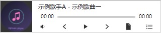

# xqmusic-player

一个轻量的浏览器端音乐播放器小部件：歌单、封面、进度条、静音切换与滚动歌词。
同时提供 UMD 构建和 Vue 3 组件。

[English](./README.md) | 中文

## 前置依赖

包本身很小，但确实依赖宿主页面提供两样东西：

| 依赖 | 是否必需 | 用途 | 怎么提供 |
| --- | --- | --- | --- |
| 全局 `$g`（[xqgjs](https://www.npmjs.com/package/xqgjs)） | **必需** | 解析宿主元素（`$g.dom`）、拖拽模式（`$g.Drag`） | `npm i xqgjs`，或引入 `https://xqgj.cc/xqcdn/libs/xqgjs/xqgjs.min.js` |
| Font Awesome 6 | 建议 | 生成的按钮图标用的是 `fa fa-*` 类名 | 引入 `all.min.css`，或自己覆盖 `.fa` 的图标 |
| `fetch` | 建议 | 歌词用 `fetch` 拉取；只有在没有 `fetch` 的老浏览器里才退回全局 `axios` | 现代浏览器自带 |

缺少 `$g` 时构造函数会立刻抛出 `[xqmusic-player] 缺少前置依赖 $g…`，
而不是等到后面某个地方报不明所以的 `undefined is not a function`。

## 安装

```sh
npm i xqmusic-player
```

## 浏览器直接引入（UMD / 全局）

```html
<link rel="stylesheet" href="https://cdn.bootcdn.net/ajax/libs/font-awesome/6.2.0/css/all.min.css">
<link rel="stylesheet" href="node_modules/xqmusic-player/lib/css/xqmusic.min.css">

<div id="music"></div>

<script src="https://xqgj.cc/xqcdn/libs/xqgjs/xqgjs.min.js"></script>
<script src="node_modules/xqmusic-player/lib/js/xqmusic.min.js"></script>
<script>
    new XqMusic({
        el: '#music',
        list: [],
        mode: 'slide', // 'slide' | 'move'
    });
</script>
```

`lib/js/xqmusic.min.js` 是 `lib/js/xqmusic.js` 的压缩产物，`npm run build:check`
会校验两者是否一致，所以用哪个都一样。

## 作为模块引入

```js
// CommonJS
const XqMusic = require('xqmusic-player');
// 同时也挂在 XqMusic.XqMusic 与 XqMusic.default 上

// 纯工具函数不碰 DOM，单独提供真正的 ESM 入口
import { escapeHtml, pad2, formatTime, parseLyric, findLyricIndex } from 'xqmusic-player/utils';
```

```html
<script type="module">
    import { formatTime } from './node_modules/xqmusic-player/lib/js/xqmusic-utils.mjs';
    console.log(formatTime(610).m); // 10:10
</script>
```

## Vue 3 组件

```js
import { createApp } from 'vue';
import App from './App.vue';
import xqMusic from 'xqmusic-player/vue';

createApp(App).use(xqMusic).mount('#app');
```

```vue
<template>
    <xq-music :list="list" />
</template>

<script setup>
import { onMounted, ref } from 'vue';

const list = ref([]);

onMounted(async () => {
    const res = await fetch('/mock/music.json');
    list.value = await res.json();
});
</script>
```

插件会把组件注册成 `xq-music` 和 `xqMusic` 两个名字，两种写法都能命中。
也可以直接用单文件组件：`import XqMusic from 'xqmusic-player/xqmusic.vue'`。

> **不支持 Vue 2。** 组件用的是 `<script setup>`，需要 Vue 3（`@vue/compiler-sfc` ≥ 3.2）。
> 兼容两个大版本的方案见 [`docs/RFC-2.0.0.md`](./docs/RFC-2.0.0.md)。

组件不再要求宿主注入 `$http`／`axios`，也不再需要 `less` 预处理器；
它直接使用和 UMD 版同一份 `lib/css/xqmusic.css`。

## 配置项

| 参数 | 类型 | 默认值 | 说明 |
| --- | --- | --- | --- |
| `el` | `string \| Element` | —（**必填**） | 播放器注入的宿主元素或选择器 |
| `list` | `Array` | `[]` | 歌曲列表，结构见下 |
| `mode` | `'slide' \| 'move'` | `'slide'` | `slide` 收在右下角、鼠标移上去滑出；`move` 可拖拽（需要 `$g.Drag`） |

### 歌曲字段

```json
[
    {
        "id": 1,
        "name": "麻雀",
        "author": "李荣浩",
        "pic": "./lrh-mq.jpg",
        "lyric_url": "./lrh-mq.lrc",
        "url": "./lrh-mq.mp3"
    }
]
```

| 字段 | 类型 | 说明 |
| --- | --- | --- |
| `id` | `number \| string` | 列表内唯一，用于高亮当前行 |
| `name` | `string` | 标题，渲染前会转义 |
| `author` | `string` | 显示在标题前 |
| `pic` | `string` | 封面图地址，作为 `background-image` 使用 |
| `url` | `string` | 音频文件地址 |
| `lyric_url` | `string` | 可选。没有时面板显示「暂无歌词」 |

`id` 和 `name` 写进 `innerHTML` 之前都会转义，歌名里带尖括号也不会注入出标签。

## 对外 API

```js
const player = new XqMusic({ el: '#music', list });

player.playSong();              // 播放 / 暂停
player.togglePrevSong();
player.toggleNextSong();
player.toggleListSong(event);   // 播放被点击的那一行
player.toggleMusic();           // 重新渲染当前歌曲但不播放
player.setMuted(true);          // 返回新的静音状态
player.setLyricSource(url);     // 换歌词源；不传则清空
player.getLyric(url);           // Promise<Object|null>
player.parseLyric(text);        // { ti, ar, al, by, offset, ms: [{ t, c }] }
player.calcTimeStr(610);        // { h: '00:10:10', m: '10:10' }
player.destroy();               // 解绑全部监听、暂停音频、移除 DOM

XqMusic.VERSION;                // '1.2.1'
XqMusic.utils;                  // { escapeHtml, pad2, formatTime, parseLyric, findLyricIndex }
```

几个值得注意的行为：

- **同页可以放多个实例**。所有查询都在实例自己的根节点内按类名查找；
  DOM 上保留的 `id` 只是给仍然依赖 `getElementById` 的使用者。
- **歌词**以内存为主，并写进 `localStorage` 的实例级键（`xqmusic:lyric:<n>`）；
  请求失败时从这里回读。旧版本那个全局共享键 `lyrcis`（是的，当年拼错了）会被迁移一次然后删除。
- **切歌**会作废正在飞的歌词请求，慢响应不会覆盖当前播放的歌。
- **`destroy()`** 是幂等的。移除宿主节点前务必调用，否则 `timeupdate` 监听会一直跑。

## 开发

```sh
npm install
npm test              # 纯函数 / 文件契约 / 桩 DOM 行为（源码与压缩产物各跑一遍）
npm run test:harness  # 只跑桩 DOM 场景
npm run build         # 用 esbuild 重新生成 min.js / min.css
npm run build:check   # 提交的产物与源码不一致就报错
npm run test:browser  # 起 HTTP 服务，人工打开 ./test
npm run verify:browser # 用本机 Chrome / Edge 自动跑四个测试页
```

`test/` 下四个页面都是自检的：顶部状态区会把 PASS / FAIL 显示出来，并且最后一定留一个能播的实例——
人在浏览器里看到的结果，和机器从 `window.__TEST_RESULTS__` 读到的结果一致。

## 预览



## 更新记录

见 [CHANGELOG.md](./CHANGELOG.md)。破坏性变更提案见 [docs/RFC-2.0.0.md](./docs/RFC-2.0.0.md)。

## 反馈

[提交问题](https://github.com/gitguanqi/xqmusic-player/issues/new)

## 作者

[@gitguanqi](https://github.com/gitguanqi)

## 协议

MIT
